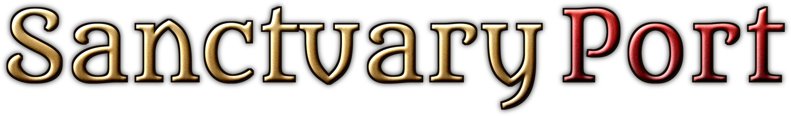

<p align="center">
  
</p>

<p align="center">
  <b>A native PC port of Diablo III: Reaper of Souls – Ultimate Evil Edition (PS4)</b><br>
  English · <a href="COMO_JOGAR.md">Português (Brasil)</a>
</p>

<p align="center">
  <a href="https://recomplauncher.com/game/sanctuaryport"><picture><source media="(prefers-color-scheme: dark)" srcset="https://recomplauncher.com/assets/press/launcher/badge-light.svg"></picture></a>
</p>

<p align="center">
  <a href="https://buymeacoffee.com/cadugimenek"></a>
</p>

---

SanctuaryPort runs the PlayStation 4 version of **Diablo III** natively on a PC: the Brazilian
(CUSA00243), US (CUSA00242) and European (CUSA00433/CUSA00434) releases of *Reaper of Souls –
Ultimate Evil Edition*, with each one's last update (1.47 for the Brazilian and US ones, 1.46 for
the European one), which is the **Eternal Collection** (2.7.7, or 2.7.6 for the European 1.46, with the Necromancer). The game's original x86-64 code runs directly on your
processor, a runtime replaces the PS4 system libraries, and the PS4 GPU commands are translated to
Vulkan by a video core derived from [shadPS4](https://github.com/shadps4-emu/shadPS4). There is no
CPU emulator.

> [!IMPORTANT]
> **SanctuaryPort is the port only — the game is not included and is not distributed here.**
> This repository and its releases hold the runtime that recompiles and runs the PS4 code, the
> GPU translation layer and the launcher. No Diablo III files (executables, data, PKGs, keys or
> artwork) are part of the source or of any download, and none will be provided. To play, you
> need your own copy of the game, dumped from a PS4 you own.
>
> This project is not affiliated with or endorsed by Blizzard Entertainment or Sony Interactive
> Entertainment. Diablo is a trademark of Blizzard Entertainment, Inc.

## Download

Get the latest build from the [Releases](https://github.com/CaduGimenes/SanctuaryPort/releases):

- **Linux:** `SanctuaryPort-linux-x86_64.AppImage` — make it executable and run it. Needs a distro
  with glibc 2.39 or newer (SteamOS, Ubuntu 24.04+, Debian 13, Fedora 40+...), `python3`, and
  a GPU with Vulkan 1.3. Saves and settings go to `~/.local/share/sanctuaryport`, or, if you create
  a `SanctuaryPort-data` folder next to the AppImage, into that folder (portable mode).
  `SanctuaryPort-linux-x86_64.tar.gz` is the same thing as a plain folder: extract it and run
  `SanctuaryPort` inside; it is portable (everything stays in its `SanctuaryPort-data`).
- **Windows:** `SanctuaryPort-windows.zip` — extract it and open `SanctuaryPort.exe`
  (instructions in `README-Windows.txt`). Python comes inside the folder.

Then follow [Getting your game ready](#getting-your-game-ready) with your own dump.

## Status

**Playable.** Developed on Linux (AMD Radeon 780M / 760M, Mesa) with the Brazilian 1.47 and US 1.00 dumps, and played by the community on the hardware below:

| | |
|---|---|
| ✅ Title screen, hero creation, cinematics, Act I world | 60 FPS, 20+ minute sessions without a crash |
| ✅ Saving and *Continue* | saves live in `user/savedata/` (backed up on every start) |
| ✅ **Local co-op for up to 4 players** | every extra gamepad is one more player |
| ✅ **Xbox button icons** in the game's prompts and HUD | optional, drawn over the game's own icons |
| ✅ DLC entitlements | from your own add-on packages; they need the game's update 1.46 or later (the launcher warns otherwise) |
| ✅ Install straight from your PKG files | in the launcher, no external tools |
| ✅ Languages | whatever your dump ships, in any region's release (English, French, Spanish, Portuguese, German, Italian, Polish, Russian...) |
| ✅ **Trophies** | an on-screen notice with the trophy's name as you earn it, the platinum by itself, and a Trophies page in the launcher |
| ✅ Render resolution 480p–4K, ultrawide 21:9 / 32:9, 16:10 (Steam Deck 1280x800) | resolution patches (the camera widens to the screen); FSR 1 upscaling and RCAS sharpening |
| 🧪 FSR 3 (experimental) | upscaling to the window with temporal anti-aliasing, the HUD at full size (Graphics > Upscaling) |
| ✅ FXAA | cheap anti-aliasing of the 3D picture before the HUD (Graphics > More options), when FSR 3 is off |
| 🧪 GTAO | ambient occlusion in place of the game's SSAO, Low or High (Graphics > GTAO) |
| ✅ **Frame rate 30 / 60 / 120 / 200** | the game's own frame limiter (Graphics > Frame rate; 200 is the game's own maximum); the game's speed stays the same; at 60 and above each frame is shown as soon as it is done (VRR and gamescope friendly) |
| 🧪 Game MSAA on AMD and Intel (Windows) | off by default there (black lines); On is experimental: its depth is created without compression (Graphics > More options) |
| 🧪 MSAA 2x / 4x | the game's scene drawn with more samples and averaged into the picture, as on PC; 4x costs about a quarter of the FPS (Graphics > More options > MSAA samples) |
| ✅ Smooth character motion above 60 FPS | on by default (Graphics, below the frame rate): above 60 FPS the hero and monsters otherwise move every other frame |
| ✅ **Offline seasons** | seasonal heroes offline (Seasons 14–40, with the Season Journey), the seasons' community events and The Darkening of Tristram (launcher → *Seasons*) |
| ✅ Updates | from their own folder, read over the game in place: nothing is copied, on any drive (microSD cards on the ROG Ally / Steam Deck included); the base game is never changed |
| ✅ Windows 10 / 11, Linux, SteamOS | played by the community on NVIDIA, AMD and Intel graphics, Steam Deck / Steam Machine and ROG Ally; every release is also tested under Wine |
| ✅ Cosmetics of other platform editions | optional, on the Game page: wings, pet and portrait frame of another console edition that are already in the PS4 data (your saves are backed up first) |
| 🧪 Cheats | optional and off by default, on the Game page under *Cheats*: movement speed +25%, auto pickup, Kanai's Cube keeps materials, all difficulties unlocked |
| ✅ Story order | optional: the Mystic joins only from Act V, as before she became account-wide in Act I (Game page) |
| ❌ Online play / PSN | offline only |

## The launcher

`launcher-rust/` is the SanctuaryPort launcher, a Rust/[iced](https://iced.rs) app adapted from
[SpartanPort](https://github.com/FelipePrado0/SpartanPort)'s launcher:

- **Home** with your game's own key art (`sce_sys/pic1.png`, read from your dump; nothing is shipped);
- **Graphics**: display mode, frame rate, V-Sync, render resolution and aspect ratio, upscaling
  (FSR 1 / FSR 3), sharpening and GTAO; dynamic resolution, MSAA, FXAA and texture filtering under
  *More options*; the graphics card choice when there are two;
- **Game**: game folder, language, player profiles, saves, and **installation from PKG** (base game, update and add-ons);
- **Seasons**: the offline season, with its events, rotation and the Tristram portal under *Details*;
- **Trophies**: every trophy with its icon (from your dump), name and description, and which ones you
  have earned with the port;
- **Controls** (keyboard, mouse and gamepad mapping, button icon style) and **Advanced** (launcher
  options, shortcuts, files, and *Troubleshooting*: shader cache, shader loading and the log of the
  last start).

Its interface follows your system language (English, Portuguese and many more), and it works
with a gamepad alone: **LB / RB** change tab, **A / Start** on Home plays, **B** goes back.

### Command line

The same options on Windows (`SanctuaryPort.exe`) and Linux (the AppImage or `SanctuaryPort` in the
tarball). `Play SanctuaryPort.exe` (Windows) is `--play` without a console window, for Steam and
shortcuts.

```
--play                 start the game with the saved settings, without the launcher window
--game DIR             the game folder (with eboot.bin), for this start
--update DIR           the update folder, for this start
--data-dir DIR         keep settings, saves and generated files in DIR
--fullscreen | --borderless | --windowed
                       the display mode (saved, as the Graphics page does)
--set KEY=VALUE        any sanctuary.ini setting, e.g. --set frame_rate=120 (saved; repeatable);
                       frame_rate takes any rate from 30 to 200 and render_resolution any
                       WIDTHxHEIGHT (even numbers, 640x360 to 7680x4320), e.g. 1700x956
--install-pkg PKG DIR  install a game, update or add-on PKG into the games folder DIR
--version, --help
```

For example, straight into the game in full screen at 120 FPS:
`SanctuaryPort.exe --play --fullscreen --set frame_rate=120 --game D:\PS4\CUSA00242`.
The launcher's lists offer the usual rates and sizes; another one (a 144 Hz or 75 Hz screen, a
window of an odd size) goes in `sanctuary.ini` (`frame_rate=144`, `render_resolution=1700x956`) or
through `--set`, and the Graphics page then shows it in its list.

## Building from source (Linux)

You need a C/C++ toolchain (clang or gcc), CMake, Ninja, SDL3, the Vulkan headers and loader,
Python 3.10+ (Pillow optional, for the window icon) and [rustup](https://rustup.rs) for the
launcher (it installs the Rust version `launcher-rust/rust-toolchain.toml` pins). On Ubuntu
24.04, `bash packaging/linux/ci-deps.sh` installs everything; with Nix, `nix-shell`.

```bash
git clone --recursive https://github.com/CaduGimenes/SanctuaryPort.git
cd SanctuaryPort
bash build.sh            # if CMake cannot find vk_mem_alloc.h:
                         # CMAKE_INCLUDE_PATH=$PWD/third_party/vma/include bash build.sh
cargo build --release --manifest-path launcher-rust/Cargo.toml
```

Packages: `bash packaging/linux/build.sh` makes the AppImage (release builds come from
[.github/workflows/release.yml](.github/workflows/release.yml) on Ubuntu 24.04), and
`bash packaging/windows/package.sh` cross-compiles the Windows zip from Linux — see
[packaging/windows/README.md](packaging/windows/README.md), which also covers building on Windows
with MSYS2.

## Getting your game ready

1. Dump **Diablo III** (the Brazilian CUSA00243 or US CUSA00242 release with its 01.47 update, or
   the European CUSA00433/CUSA00434 with its 01.46 update) from your own PS4 as fake PKG files: base game, update and,
   if you have them, the add-ons. This project does not provide the game or help obtaining it.
2. Start the launcher (the AppImage, `SanctuaryPort.exe`, or
   `launcher-rust/target/release/sanctuaryport-launcher` from source), open **Game** and
   choose **Install from PKG** with the game, its update and add-ons. The game goes to
   `~/Games/PS4/<TITLE_ID>`, the update to `<TITLE_ID>-UPDATE` and the add-ons to `addcont/`;
   the launcher sets the folders. The same works from a terminal:

   ```bash
   launcher-rust/target/release/sanctuaryport-launcher --install-pkg <file.pkg> ~/Games/PS4
   ```

   An already extracted dump works too: point the launcher at the folder that holds `eboot.bin`.

   Keep the game and its update in separate folders: the port reads the update over the game in
   place, without copying anything. Add-ons (the Necromancer) need the update (1.46 or later):
   1.00 has no Necromancer.

## Playing

Press **PLAY** in the launcher, or from a terminal:

```bash
SANCTUARY_GAME_DIR=~/Games/PS4/CUSA00243 SANCTUARY_PATCH_DIR=~/Games/PS4/CUSA00243-UPDATE bash run.sh
```

- **Gamepads** (Xbox, DualSense, DualShock 4, anything SDL recognises) work out of the box.
  Keyboard and mouse work too, with these default keys (change them in the launcher's
  *Controls*):

  | Key | PS4 button |
  |---|---|
  | W A S D | left stick (move) |
  | Arrow keys | right stick (evade) |
  | Space | ✕ |
  | Left Shift | ○ |
  | Left mouse button / right mouse button | □ / △ |
  | Q / E | L1 (potion) / R1 |
  | R / mouse forward button | L2 / R2 |
  | Z / X | L3 / R3 |
  | 1 2 3 4 | d-pad up, right, down, left |
  | Tab | Options |
  | P / Esc | touchpad left / right |
  | Insert | the port's menu (cannot be changed) |
  | F12 | screenshot (`user/screenshots/`) |
- **Local co-op:** connect more gamepads. The first one is player 1; another one joins when you
  press a button on it, as player 2, 3 or 4 in the order the buttons are pressed (so a device that
  only reports motion, like a DualSense's motion sensors on Linux, never takes a seat). Press the
  bottom face button (A / ✕) on the new gamepad to join.
- **Player profiles:** launcher → *Game* → *Players*. Each profile has its own saves and name, and
  you can make as many as you like. Each controller the launcher has seen (and the keyboard) gets
  the profile it plays, or *Ask*: that player picks a profile (or makes a new one) in the game when
  their controller joins (with only one profile, nobody is asked). Players join in the order they
  press a button, the first being player 1,
  so anyone can play solo with their own heroes, and a missing player is simply not there.
- **Xbox button icons:** launcher → *Controls* → *Gamepad* → *In-game button icons* → *Xbox* (or
  *Match my controller*). Your game files are never changed.
- **In-game port menu:** `Insert` (or R3 + L2). **Screenshot:** `F12` (`user/screenshots/`).

## Known issues

- The analog stick icons still read L3/R3 with Xbox icons on; Nintendo letters are not drawn yet.
- Ultrawide: 21:9 (2560x1080, 3440x1440, 3840x1600) and 32:9 (5120x1440) render resolutions, with
  the camera widened to them (Graphics > Aspect ratio); 2560x1080 checked in game, the others
  use the same patch. 16:10: 1280x800 (Steam Deck), 1920x1200 and 2560x1600; 1280x800 checked in game.

## Road to 1.0 and reporting problems

1.0 ships when the whole campaign can be played on common hardware without help. Tell how far you
got, and on which device, in the pinned issue
[Road to 1.0](https://github.com/CaduGimenes/SanctuaryPort/issues/30).

For a problem, open an issue with the bug template. After a crash, attach `user/last_crash.log`
(written automatically). For anything else, turn on **Advanced → Troubleshooting → Save a log of
each start** (off by default, so nothing is written to disk while you play), play until it happens
and attach `user/last_run.log`. For stutter or frame drops, turn on **Advanced → Troubleshooting →
Detailed performance log** instead and play the same spot: the log then records the frame pacing,
every long frame and the video memory every 5 seconds.

## How it works

See [docs/DIABLO3.md](docs/DIABLO3.md) for the Diablo III specifics (game profile, co-op, button
icon replacement, PKG installer, debugging switches and reverse-engineering helpers) and
[docs/](docs/) for the shared runtime and GPU core.

## Credits

SanctuaryPort stands on the work of others:

- [knack_pc](https://github.com/AbdelmoumenDeghbouche/knack_pc) and
  [wipeout_pc](https://github.com/AbdelmoumenDeghbouche/wipeout_pc) by Abdelmoumen Deghbouche:
  the native PS4 runtime this port is built on (its full history is kept in this repository);
- [SpartanPort](https://github.com/FelipePrado0/SpartanPort) by Felipe Prado: the launcher;
- [bbport](https://github.com/deadinside28/bloodborne_pc): the native port approach;
- [shadPS4](https://github.com/shadps4-emu/shadPS4): the video core and shader recompiler;
- [LibOrbisPkg](https://github.com/maxton/LibOrbisPkg): the PKG/PFS format knowledge behind the
  installer;
- fonts: Metamorphous and Cinzel (SIL Open Font License), DejaVu.

## License

[GPL-2.0](LICENSE), like the projects it derives from. Third-party code under `gpu/third_party/`
and `third_party/` keeps its own licenses. The license covers this project's code only; it grants
nothing over Diablo III, which belongs to its owners.
