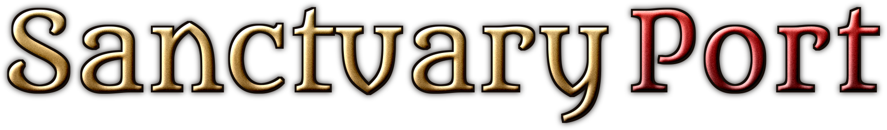

<p align="center">
  
</p>

<p align="center">
  <b>A native PC port of Diablo III: Reaper of Souls – Ultimate Evil Edition (PS4)</b><br>
  English · <a href="COMO_JOGAR.md">Português (Brasil)</a>
</p>

---

SanctuaryPort runs the PlayStation 4 version of **Diablo III** natively on a PC: the Brazilian
release (CUSA00243) with its 1.47 update, which is the **Eternal Collection** (2.7.7, with the
Necromancer), and the US *Reaper of Souls – Ultimate Evil Edition* 1.00 (CUSA00242). The game's original x86-64 code runs directly on your
processor, a runtime replaces the PS4 system libraries, and the PS4 GPU commands are translated to
Vulkan by a video core derived from [shadPS4](https://github.com/shadps4-emu/shadPS4). There is no
CPU emulator.

> [!IMPORTANT]
> **SanctuaryPort is the port only — the game is not included and is not distributed here.**
> This repository and its releases hold the runtime that recompiles and runs the PS4 code, the
> GPU translation layer and the launcher. No Diablo III files (executables, data, PKGs, keys or
> artwork) are part of the source or of any download, and none will be provided. To play, you
> need your own copy of the game, dumped from a PS4 you own.
>
> This project is not affiliated with or endorsed by Blizzard Entertainment or Sony Interactive
> Entertainment. Diablo is a trademark of Blizzard Entertainment, Inc.

## Download

Get the latest build from the [Releases](https://github.com/CaduGimenes/SanctuaryPort/releases):

- **Linux:** `SanctuaryPort-x86_64.AppImage` — make it executable and run it. Needs a distro
  with glibc 2.39 or newer (SteamOS, Ubuntu 24.04+, Debian 13, Fedora 40+...), `python3`, and
  a GPU with Vulkan 1.3. Saves and settings go to `~/.local/share/sanctuaryport`.
- **Windows:** `SanctuaryPort-windows.zip` — extract it and open `SanctuaryPort.exe`
  (instructions in `README-Windows.txt`). Python comes inside the folder.

Then follow [Getting your game ready](#getting-your-game-ready) with your own dump.

## Status

**Playable.** Tested on Linux (AMD Radeon 780M, Mesa) with the Brazilian 1.47 and US 1.00 dumps:

| | |
|---|---|
| ✅ Title screen, hero creation, cinematics, Act I world | 60 FPS, 20+ minute sessions without a crash |
| ✅ Saving and *Continue* | saves live in `user/savedata/` (backed up on every start) |
| ✅ **Local co-op for up to 4 players** | every extra gamepad is one more player |
| ✅ **Xbox button icons** in the game's prompts and HUD | optional, drawn over the game's own icons |
| ✅ DLC entitlements | from your own add-on packages |
| ✅ Install straight from your PKG files | in the launcher, no external tools |
| ✅ Languages | whatever your dump ships, in any region's release (English, French, Spanish, Portuguese, German, Italian, Polish, Russian...) |
| ✅ **Trophies** | an on-screen notice with the trophy's name as you earn it, the platinum by itself, and a Trophies page in the launcher |
| ✅ Render resolution 480p–4K | resolution patches; FSR 1 upscaling and RCAS sharpening |
| ✅ Updates | the 1.47 update (Eternal Collection) from its own folder; the base game is never changed |
| ⚠️ Windows | packaged and played under Wine (new hero, Act I, combat, saves); not yet played on a real Windows PC |
| ❌ Online play / PSN | offline only |

## The launcher

`launcher-rust/` is the SanctuaryPort launcher, a Rust/[iced](https://iced.rs) app adapted from
[SpartanPort](https://github.com/FelipePrado0/SpartanPort)'s launcher:

- **Home** with your game's own key art (`sce_sys/pic1.png`, read from your dump; nothing is shipped);
- **Graphics / Performance**: render resolution, window mode, FSR 1 upscaling, frame limit;
- **Game**: game folder, language, saves, and **installation from PKG** (base game and add-ons);
- **Trophies**: every trophy with its icon (from your dump), name and description, and which ones you
  have earned with the port;
- **Controls** (keyboard, mouse and gamepad mapping, button icon style), **Advanced**, **Log**.

Its interface follows your system language (English, Portuguese and many more).

## Building from source (Linux)

You need a C/C++ toolchain (clang or gcc), CMake, Ninja, SDL3, the Vulkan headers and loader,
Python 3.10+ (Pillow optional, for the window icon) and [rustup](https://rustup.rs) for the
launcher (it installs the Rust version `launcher-rust/rust-toolchain.toml` pins). On Ubuntu
24.04, `bash packaging/linux/ci-deps.sh` installs everything; with Nix, `nix-shell`.

```bash
git clone --recursive https://github.com/CaduGimenes/SanctuaryPort.git
cd SanctuaryPort
bash build.sh            # if CMake cannot find vk_mem_alloc.h:
                         # CMAKE_INCLUDE_PATH=$PWD/third_party/vma/include bash build.sh
cargo build --release --manifest-path launcher-rust/Cargo.toml
```

Packages: `bash packaging/linux/build.sh` makes the AppImage (release builds come from
[.github/workflows/release.yml](.github/workflows/release.yml) on Ubuntu 24.04), and
`bash packaging/windows/package.sh` cross-compiles the Windows zip from Linux — see
[packaging/windows/README.md](packaging/windows/README.md), which also covers building on Windows
with MSYS2.

## Getting your game ready

1. Dump **Diablo III** (the Brazilian CUSA00243 release with its 01.47 update, or the US
   CUSA00242 *Ultimate Evil Edition*) from your own PS4 as fake PKG files: base game, update and,
   if you have them, the add-ons. This project does not provide the game or help obtaining it.
2. Start the launcher (the AppImage, `SanctuaryPort.exe`, or
   `launcher-rust/target/release/sanctuaryport-launcher` from source), open **Game** and
   choose **Install from PKG** with the game, its update and add-ons. The game goes to
   `~/Games/PS4/<TITLE_ID>`, the update to `<TITLE_ID>-UPDATE` and the add-ons to `addcont/`;
   the launcher sets the folders. The same works from a terminal:

   ```bash
   launcher-rust/target/release/sanctuaryport-launcher --install-pkg <file.pkg> ~/Games/PS4
   ```

   An already extracted dump works too: point the launcher at the folder that holds `eboot.bin`.

## Playing

Press **PLAY** in the launcher, or from a terminal:

```bash
SANCTUARY_GAME_DIR=~/Games/PS4/CUSA00243 SANCTUARY_PATCH_DIR=~/Games/PS4/CUSA00243-UPDATE bash run.sh
```

- **Gamepads** (Xbox, DualSense, DualShock 4, anything SDL recognises) work out of the box.
  Keyboard and mouse work too, with these default keys (change them in the launcher's
  *Controls*):

  | Key | PS4 button |
  |---|---|
  | W A S D | left stick (move) |
  | Arrow keys | right stick (evade) |
  | Space | ✕ |
  | Left Shift | ○ |
  | Left mouse button / right mouse button | □ / △ |
  | Q / E | L1 (potion) / R1 |
  | R / mouse forward button | L2 / R2 |
  | Z / X | L3 / R3 |
  | 1 2 3 4 | d-pad up, right, down, left |
  | Tab | Options |
  | P / Esc | touchpad left / right |
  | Insert | the port's menu (cannot be changed) |
  | F12 | screenshot (`user/screenshots/`) |
- **Local co-op:** connect more gamepads. The first one is player 1; the next ones become players
  2, 3 and 4 in the order they connect. In the game, press the bottom face button (A / ✕) on the
  new gamepad to join.
- **Xbox button icons:** launcher → *Controls* → *Gamepad* → *In-game button icons* → *Xbox* (or
  *Match my controller*). Your game files are never changed.
- **In-game port menu:** `Insert` (or R3 + L2). **Screenshot:** `F12` (`user/screenshots/`).

## Known issues

- The analog stick icons still read L3/R3 with Xbox icons on; Nintendo letters are not drawn yet.
- At 720p and below some HUD key labels can disappear.
- Ultrawide (21:9) is not supported yet.

## How it works

See [docs/DIABLO3.md](docs/DIABLO3.md) for the Diablo III specifics (game profile, co-op, button
icon replacement, PKG installer, debugging switches and reverse-engineering helpers) and
[docs/](docs/) for the shared runtime and GPU core.

## Credits

SanctuaryPort stands on the work of others:

- [knack_pc](https://github.com/AbdelmoumenDeghbouche/knack_pc) and
  [wipeout_pc](https://github.com/AbdelmoumenDeghbouche/wipeout_pc) by Abdelmoumen Deghbouche:
  the native PS4 runtime this port is built on (its full history is kept in this repository);
- [SpartanPort](https://github.com/FelipePrado0/SpartanPort) by Felipe Prado: the launcher;
- [bbport](https://github.com/deadinside28/bloodborne_pc): the native port approach;
- [shadPS4](https://github.com/shadps4-emu/shadPS4): the video core and shader recompiler;
- [LibOrbisPkg](https://github.com/maxton/LibOrbisPkg): the PKG/PFS format knowledge behind the
  installer;
- fonts: Metamorphous and Cinzel (SIL Open Font License), DejaVu.

## License

[GPL-2.0](LICENSE), like the projects it derives from. Third-party code under `gpu/third_party/`
and `third_party/` keeps its own licenses. The license covers this project's code only; it grants
nothing over Diablo III, which belongs to its owners.
